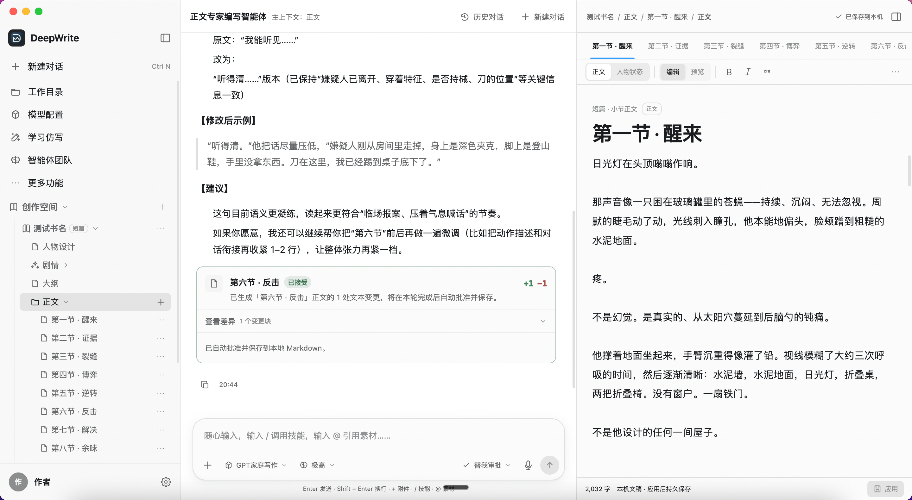
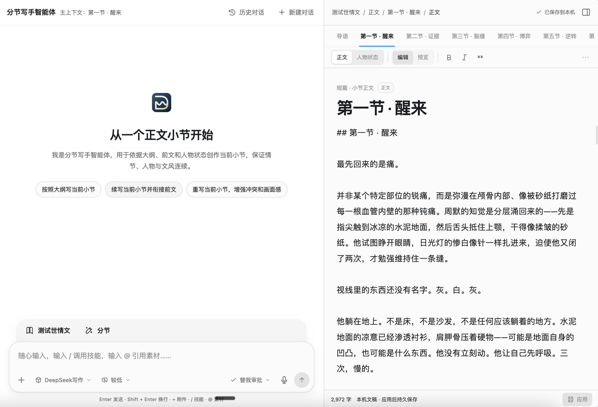
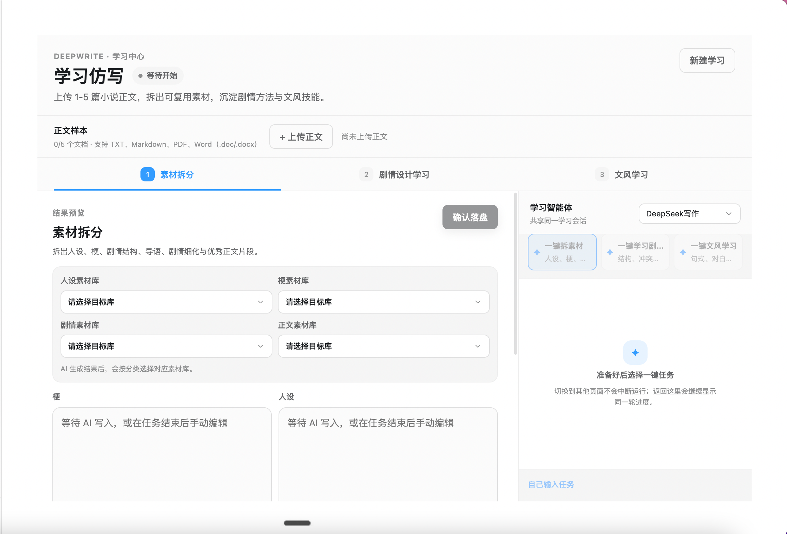

# 虚拟世界

## 当前工作方式

应用保留小说、角色资产、正文插画、技能库、素材库和提示词模板的手动管理界面。创作编排交给外部 Agent；内置主智能体聊天区、子智能体团队、修改分析、更多功能菜单和设置中的创作分组已移除。声音管理位于主菜单，声音设计继续使用设置中选择的默认自定义模型。

### 可编辑工具

打开“工具管理”后，会首次在应用工作目录中安装四套工具：

| 工具 | 用途 |
| --- | --- |
| 创作工具 | 以提示词编排上下文、设计、写作、检查与连续性维护 |
| 创作上下文工具 | 整合本书约束、技能库、素材库及原资料管理方法 |
| 创作空间工具 | 独立 CLI 管理小说文件、结构、人物与连续性账本 |
| 插图工具（常规版） | 读取剧情、前文插图和角色资产，生成静态插图并插入正文 |

工具保存在 `工作目录/tools/<id>/`，包含 `tool.json`、说明以及必要的 CLI/runtime 文件。工具管理可编辑这些文件、查看关联和反向引用并逐级跳转。修改后下次外部调用读取新文件；初始化后不会覆盖用户修改或恢复已删除的工具。换电脑时需连同工作目录迁移。

使用“复制入口路径”将工具交给 Codex、Claude 等外部 Agent。CLI 需要 Node.js 24+，应用无需保持运行，也不需要安装额外 node_modules：

```sh
node /工作目录/tools/workspace/cli.mjs --book /小说目录 --input /请求.json
```

各工具的 `SKILL.md` 提供调用说明，复杂操作用 `schema` 查询字段。应用源码中的 `toolkit/defaults` 只用于首次安装工具；后续构建不会覆盖工作目录中的用户修改。沿用现有 `deepwrite.json` 和 Markdown 格式；剪贴板、文件弹窗、模型密钥及声音平台调用继续由应用提供。

以下为原项目说明，旧智能体界面的截图和介绍仅作为历史参考。

[中文](./README.md) · [English](./README.en.md) · [下载安装包](https://github.com/swjybky/deepwrite/releases)

> 面向创作者的本地优先 AI 写作智能体工作台。

DeepWrite 将模型、提示词、写作技能、素材、文稿和工具组织在同一个桌面应用中。智能体可以理解当前作品的上下文，参与人物、剧情、大纲和正文创作，调用受控工具修改真实文稿，并将每一次变更交给你审阅。



## 主要特性

- **三栏写作工作台**：在同一界面管理项目与上下文、和智能体协作、阅读或编辑实际内容。
- **面向流程的专业智能体**：按人物、剧情、大纲、正文和分节写作等阶段组织不同职责。
- **可审阅的文稿修改**：所有写入先展示差异，接受后才保存，避免智能体静默覆盖正文。
- **本地优先的数据管理**：作品以 `deepwrite.json` 和 UTF-8 Markdown 文件保存，可使用 Git、同步盘或其他文本工具继续管理。
- **自选模型与服务**：支持添加自己的模型服务，并按智能体或任务切换模型与思考等级。
- **素材库、技能库与子智能体**：按作品绑定所需资料与能力，也可以组建子智能体团队处理复杂任务。
- **学习仿写**：分阶段分析参考文本，提取可复用的写作特征并用于后续创作。

## 工作方式

### 在一个视野内完成创作

DeepWrite 参考 Codex 的交互方式，将写作过程中最常用的内容放进清晰的三栏布局：

- 左侧：作品、章节、素材库、技能库与常用功能
- 中间：智能体对话、思考过程、工具执行与修改建议
- 右侧：人物、剧情、大纲、正文、素材或技能的实际内容

选择不同的创作阶段或章节时，DeepWrite 会切换对应的智能体和上下文。浏览素材与技能不会打断当前文稿，章节也可以通过独立标签快速切换。



### 让专业智能体参与写作流程

短篇创作提供多种职责明确的智能体：

- 人物智能体：设计人物、关系、动机与人物弧光
- 剧情智能体：规划主线、导语钩子、冲突、转折与结局
- 大纲智能体：将人物和剧情整理为可执行的分节大纲
- 正文专家：统筹正文结构、审阅成稿并完成润色修改
- 分节写手：围绕当前章节写作，保持情节、人物与文风连续

每个智能体都可以配置系统提示词、欢迎快捷指令和模型。短篇与剧本智能体还可以配置资料读取范围；长篇各阶段共享设定、剧情、正文与连续性账本，并可分别控制可读取的素材和技能类型。主智能体也可以带领子智能体团队协作。

### 审阅后再写入文稿

智能体不会直接覆盖你的文本。每次写入都会先生成差异对比，你可以查看新增和删除内容，再决定接受或拒绝。只有接受后的修改才会保存到本地；如果文稿已被其他操作更新，DeepWrite 会保留较新的版本，避免静默覆盖。


### 管理本地作品与知识库

DeepWrite 支持：

- 新建或打开本地作品
- 管理人物、剧情、大纲与多个正文小节
- 创建素材库和技能库，并维护 Markdown 条目
- 将指定素材库、技能库或资料分组绑定到作品
- 导入旧版书籍 ZIP，并转换为当前文件夹结构
- 自动恢复未保存草稿和最近的智能体会话

数据使用开放的本地文件格式保存，不会被锁定在应用内部。

### 使用自己的模型

你可以在模型配置中添加自己的 API 服务。当前支持：

- OpenAI Completions
- OpenAI Responses
- Anthropic Messages
- Google Generative AI

模型密钥不会暴露给页面渲染层。不同模型可以设置默认思考等级，也可以在对话过程中按任务切换。

### 学习与复用写作风格

学习仿写功能可以分阶段分析参考文本、提取可复用的写作特征，并将分析结果用于后续创作。相关模型与提示词可以在设置中单独配置。



## 安装与使用

### 使用安装包

前往 [GitHub Releases](https://github.com/swjybky/deepwrite/releases)，下载与你的系统和处理器匹配的测试安装包：

| 系统 | 安装包 |
| --- | --- |
| Windows x64 | `DeepWrite-<version>-win-x64-test.exe` |
| macOS Apple Silicon | `DeepWrite-<version>-mac-arm64-test.dmg` |
| macOS Intel | `DeepWrite-<version>-mac-x64-test.dmg` |

Windows 用户运行 `.exe` 并按安装向导完成安装。

macOS 用户打开 `.dmg`，将 DeepWrite 拖入“应用程序”文件夹。当前测试包使用 ad-hoc 签名且未经过 Apple 公证；通过浏览器、微信等渠道下载后，macOS 可能显示安全提醒。请先确认文件来源可信，再右键应用选择“打开”，或前往“系统设置 → 隐私与安全性”允许打开。

首次启动后，建议按以下顺序完成配置：

1. 选择本地工作目录。
2. 在“模型配置”中添加 API 服务并测试连接。
3. 新建作品，或打开已有的 DeepWrite 项目文件夹。
4. 按需创建并绑定素材库、技能库。

### 从源码运行

环境要求：

- Node.js 24 或更高版本
- pnpm 11 或更高版本
- Windows x64，或 macOS Apple Silicon / Intel

```bash
git clone https://github.com/swjybky/deepwrite.git
cd deepwrite
pnpm install
pnpm dev
```

常用开发命令：

```bash
pnpm dev       # 启动桌面端开发环境
pnpm build     # 构建生产版本
pnpm verify    # 运行格式、类型、边界、测试与构建校验
```

## 构建测试安装包

测试安装包必须在对应平台构建，并从仓库根目录运行：

```bash
pnpm pack:test             # 当前主机支持的全部测试包
pnpm pack:test:win         # Windows x64
pnpm pack:test:mac:arm64   # macOS Apple Silicon
pnpm pack:test:mac:x64     # macOS Intel
pnpm pack:test:mac         # 两种 macOS 架构
```

产物保存在 `apps/desktop/release/`。打包流程会先执行完整校验和生产构建，再生成并验证安装包。

## 项目结构

```text
deepwrite/
├── apps/desktop/              # Electron 桌面客户端
├── packages/contracts/        # 进程间命令与事件契约
├── packages/pi-runtime-adapter/
│                              # Agent Runtime 适配层
├── packages/shared/           # 共享类型与工具
├── tools/                     # 校验、运行与打包脚本
└── docs/images/               # README 与项目文档图片
```

DeepWrite 采用 Electron 多进程架构：Renderer 负责界面，Main 管理窗口与安全 IPC，Core Utility 负责本地项目读写，Agent Utility 负责模型和智能体运行，Tool Utility 为受控工具执行提供边界。

## 许可证

DeepWrite 基于 [Apache License 2.0](./LICENSE) 开源。
